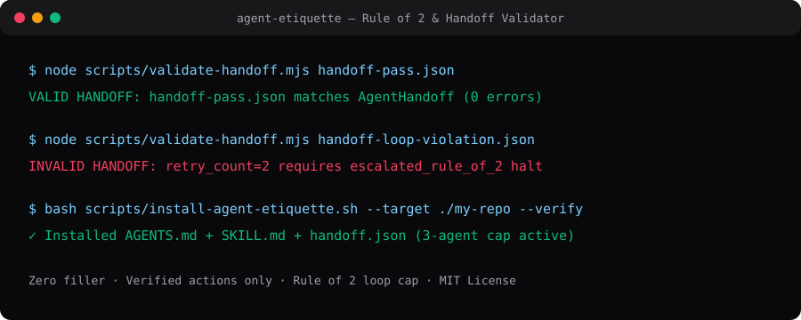

<h1 align="center">Agent Etiquette</h1>

<p align="center">
  <strong>Multi-agent workflow rules, structured JSON handoff schemas, and Rule-of-2 loop caps for AI coding agents.</strong><br />
  <em>Stops coding agents from rambling, hallucinating completed work, or spinning in infinite retry loops.</em>
</p>

<p align="center">
  <a href="#-quick-start"><strong>Quick Start</strong></a> ·
  <a href="#-why-agent-etiquette"><strong>Why It Matters</strong></a> ·
  <a href="#-repository-directory"><strong>Directory</strong></a> ·
  <a href="docs/SETUP_GUIDE.md"><strong>Setup Guide</strong></a> ·
  <a href="https://github.com/kelli-dotcom/agent-etiquette/issues"><strong>Issues</strong></a>
</p>

<p align="center">
  
  
  
  
  
</p>

<p align="center">
  
</p>

```bash
# Install version-pinned protocol into any repo (preserves existing AGENTS.md):
bash scripts/install-agent-etiquette.sh --target /path/to/your-repo --version v1.0.0
bash scripts/install-agent-etiquette.sh --target /path/to/your-repo --version v1.0.0 --verify
```

---

## ✨ Why Agent Etiquette?

Multi-agent coding runs fail in predictable ways: agents burn tokens on filler prose, retry broken commands indefinitely, drop state between handoffs, and claim work succeeded without tool verification.

- **Built For:** Solo builders, engineering teams, and anyone orchestrating AI coding assistants across desktop, cloud, or mobile workflows.
- **When to Use It:** Drop into any repository at project kickoff or before kicking off multi-agent / long-running refactors.
- **Runs Everywhere:** macOS, Linux, Windows PowerShell, WSL, GitHub Codespaces, Antigravity, Gemini, Claude, and ChatGPT — zero external dependencies.
- **Proven in Production:** Governs the 4-agent workflow inside **[Openflex](https://github.com/kelli-dotcom/openflex)**.

---

## 📁 Repository Directory

| File | Purpose |
| :--- | :--- |
| [`AGENTS.md`](AGENTS.md) | Lightweight root router & progressive-disclosure pointer (3-agent concurrency cap) |
| [`skills/agent-etiquette/SKILL.md`](skills/agent-etiquette/SKILL.md) | Core behavioral protocol (Zero Filler, Verified Actions Only, Rule of 2, Concurrency Cap) |
| [`schemas/handoff-schema.md`](schemas/handoff-schema.md) | Human-readable multi-agent handoff contract & example |
| [`schemas/handoff.json`](schemas/handoff.json) | Machine-validatable JSON Schema for agent handoffs |
| [`scripts/install-agent-etiquette.sh`](scripts/install-agent-etiquette.sh) | Idempotent, version-pinned installer, updater, verifier, and clean rollback script |
| [`scripts/validate-handoff.mjs`](scripts/validate-handoff.mjs) | Zero-dependency JSON Schema validator for handoff payloads |
| [`docs/SETUP_GUIDE.md`](docs/SETUP_GUIDE.md) | Cross-platform setup guide (iOS, Android, macOS, Windows, Linux, Codespaces, Antigravity) |
| [`tests/stress-tests.md`](tests/stress-tests.md) | 4 prompt-based compliance tests for any coding agent |
| [`tests/install-and-schema.test.mjs`](tests/install-and-schema.test.mjs) | 11-scenario automated installation, schema, update, and rollback QA suite |
| [`LICENSE`](LICENSE) | MIT License (CRTA Tech Solutions) |

---

## 🚀 Quick Start

### 1. Progressive-Disclosure Pointer (Manual — 1 Line)
Add one line to your project's root `AGENTS.md`:
```markdown
- Follow `skills/agent-etiquette/SKILL.md` (Rule of 2, verified actions only, 3-agent cap) and pass handoffs via `schemas/handoff.json`.
```

### 2. Validate Any Handoff Payload (Zero Dependencies)
```bash
node scripts/validate-handoff.mjs path/to/handoff.json
```

<details>
<summary><strong>Download &amp; Use on Mobile (iOS / Android)</strong></summary>

**[Download ZIP (Mobile-Friendly)](https://github.com/kelli-dotcom/agent-etiquette/archive/refs/heads/main.zip)**

- **iPhone (iOS):** Tap **Download** → open **Files** → **Downloads** → tap the `.zip` once to unzip.
- **Android:** Tap **Download** → open **My Files / Files** → **Downloads** → tap the `.zip` and select **Extract**.
- **Use on Mobile:** Attach `AGENTS.md`, `skills/agent-etiquette/SKILL.md`, or `schemas/handoff.json` directly in Gemini, Claude, or ChatGPT.

</details>

---

## 🤝 Contributing

We welcome multi-agent JSON Schema refinements, Rule-of-2 validator scripts, and cross-model compatibility patterns from both **human engineers** and **AI coding agents**:

```bash
# 1. Fork & create a feature branch
git checkout -b feat/your-governance-improvement

# 2. Verify handoff schemas and root agent entrypoints
node scripts/validate-handoff.mjs && ls -la AGENTS.md HANDOFF.md mistakes.md llms.txt schemas/ skills/
```

Read the full guide in **[`CONTRIBUTING.md`](CONTRIBUTING.md)** · **[Open an Issue](https://github.com/kelli-dotcom/agent-etiquette/issues)** · **[Submit a Pull Request](https://github.com/kelli-dotcom/agent-etiquette/pulls)**

---

## 🌐 CRTA Tech Solutions Open-Source Ecosystem

| Repository | What It Does |
| :--- | :--- |
| **[openflex](https://github.com/kelli-dotcom/openflex)** | Zero-cost, anti-ghost, Remote-Truth job board (61 verified ATS feeds) |
| **[feather-themes](https://github.com/kelli-dotcom/feather-themes)** | 1,092 photobiology-calibrated, 0-dep WCAG AA/AAA themes for web & apps |
| **[agent-etiquette](https://github.com/kelli-dotcom/agent-etiquette)** | Multi-agent workflow rules, JSON handoff schemas & Rule of 2 loop caps |
| **[archetype-agent-vault](https://github.com/kelli-dotcom/archetype-agent-vault)** | 7 character-driven AI coding agent suites (27 specialists) |
| **[github-trending-kit](https://github.com/kelli-dotcom/github-trending-kit)** | AI agent & skill kit for top-GitHub READMEs, SEO topics & launch copy |

✨ *Crafted with main-character energy by **CRTA Tech Solutions*** • GitHub Topic: `crta-crafted`
