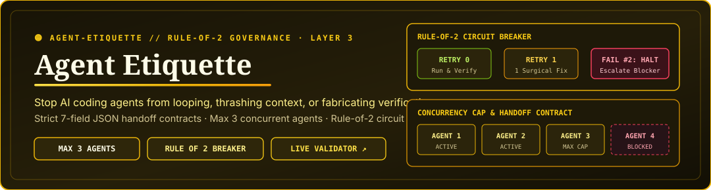

[](https://kelli-dotcom.github.io/agent-etiquette/preview/)

# Agent Etiquette

Come in. Everything here has its place, and nothing is missing.

Multi-agent workflow rules, structured JSON handoff schemas, and Rule-of-2 loop caps for AI coding agents.

**Inside**

- `skills/agent-etiquette/` — the skill
- `schemas/` — JSON handoff schemas
- `scripts/` — install and handoff validation
- [Live Handoff Validator & Rule-of-2 Simulator](https://kelli-dotcom.github.io/agent-etiquette/preview/) (`preview/index.html`) — validate handoff JSON and trigger the Rule-of-2 breaker live

**Use it**

```sh
bash scripts/install-agent-etiquette.sh --target <your-repo>
```

Details: [docs/START_HERE.md](docs/START_HERE.md). MIT license — see [LICENSE](LICENSE).
